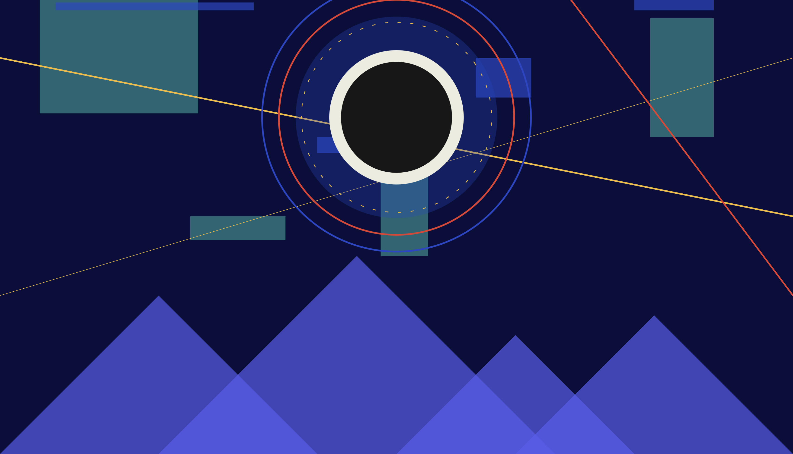

Assignment 1 - Hello World: GitHub and d3  
===

## Page URL
https://notZara.github.io/a1-ghd3/

---
## Description
I created a simple abstract landscape inspired by Kandinsky and Bauhaus-style art. 
I used circles, rectangles, lines, polygons, and various colors. The mountains hover upon being hovered over, and the eclipse scales up and down to represent its glow. 

*While I have used HTML and CSS before, this is my first time using JavaScript.
I used Claude to help fix a screen sizing issue I was experiencing that prevented an SVG from taking up the entire window.*

### Technical Achievement
I used constants for the blocks' x, y, w, and h values, as well as the mountains' x, w, and h values. This allowed be to conveniently put their sizes and positions in one place so that I can create just one SVG for each type.

### Design Achievement
I created classes in CSS to make the corresponding element scale up and down or rotate. I assigned these classes as attributes to the circles around the ellipse to create a radiating effect.

---

